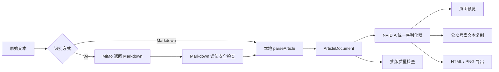

# 技术架构

## 总体数据流

两种识别方式不会分别生成 HTML。它们最终都返回同一种 `ArticleDocument`，模板只处理文章结构，不关心内容来自 Markdown 还是 AI。

## 核心数据结构

`ArticleDocument` 是解析、模板、复制和导出之间的公共协议，主要包含文章标题和内容块。内容块支持：

- `title`
- `heading`
- `paragraph`
- `quote`
- `unordered-list`
- `ordered-list`

每个内容块同时保存纯文本和经过约束的行内 HTML。标题块通过 `level` 区分二级和三级标题，列表块通过 `items` 保存列表项。

类型定义位于 `src/types/article.ts`。

## Markdown 解析

`src/utils/parseArticle.ts` 使用 markdown-it 将输入转换为 Token，再归一化为 `ArticleDocument`。解析器负责结构识别，模板负责视觉呈现，两者相互独立。

Markdown 模式直接调用该解析器。AI 模式先取得 Markdown，再调用同一个解析器，因此预览、质量检查、复制和导出不会出现两套业务逻辑。

## AI 服务

`src/services/aiArticleParser.ts` 负责 Provider 选择、MiMo 请求、Mock 延迟、超时和错误分类。真实调用使用 OpenAI 兼容的 Chat Completions 接口，AI 只允许增加 Markdown 标记和换行。

`src/services/aiMarkdown.ts` 负责：

- 去除模型偶尔返回的 Markdown 代码围栏
- 拒绝 HTML、链接、图片、代码块及不支持的 Markdown 类型
- 保留原文可见文字指纹和严格保真比较代码

严格保真校验当前没有接入主流程。恢复前需要先区分正文、数字、顺序变化与标题、列表产生的结构标点变化，避免轻微标点调整导致整次排版失败。

## NVIDIA 模板与公众号兼容

`src/utils/serializeArticle.ts` 和 `src/templates/nvidiaTheme.ts` 共同生成最终 HTML。页面预览、富文本复制和 HTML 导出都复用这一结果。

为了提高微信公众号粘贴稳定性，序列化结果：

- 主要使用 `section`、`p`、`span` 和 `strong`
- 所有关键样式使用内联 `style`
- 避免依赖外部 class、Flex、复杂定位、旋转和默认列表标记
- 使用真实字符呈现标题色条、菱形分割线和列表空心圆，避免空节点被清理
- 在最终出口使用 DOMPurify 白名单过滤

浏览器中的预览卡片阴影属于应用外壳，不会复制到公众号正文。

## 复制、导出和状态

现代浏览器通过 `ClipboardItem` 同时写入 `text/html` 与 `text/plain`；不支持时使用隐藏的可编辑容器和 `execCommand('copy')` 降级。

HTML 导出复用统一序列化结果；PNG 导出使用 html-to-image 截取带 `data-brand-article` 标记的文章主体。

应用使用 localStorage 保存原文、模板 ID 和预览模式。已经生成的预览只存在当前内存中，刷新后需要重新点击排版按钮。

## 安全边界

- 模型输出不会作为任意 HTML 直接渲染
- 最终 HTML 会经过 DOMPurify
- `.env.local` 被 Git 忽略
- `VITE_` 环境变量仍会编译进浏览器代码，无法隐藏真实 Key
- 公开部署前应将 MiMo 请求迁移到服务端代理、边缘函数或其他受控接口

